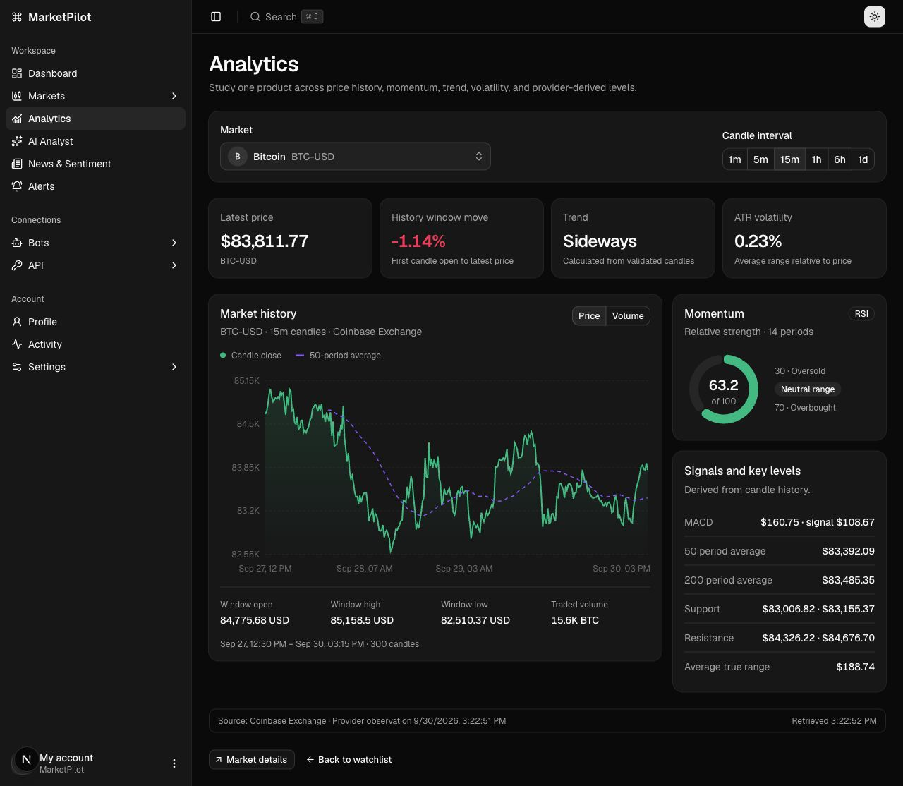
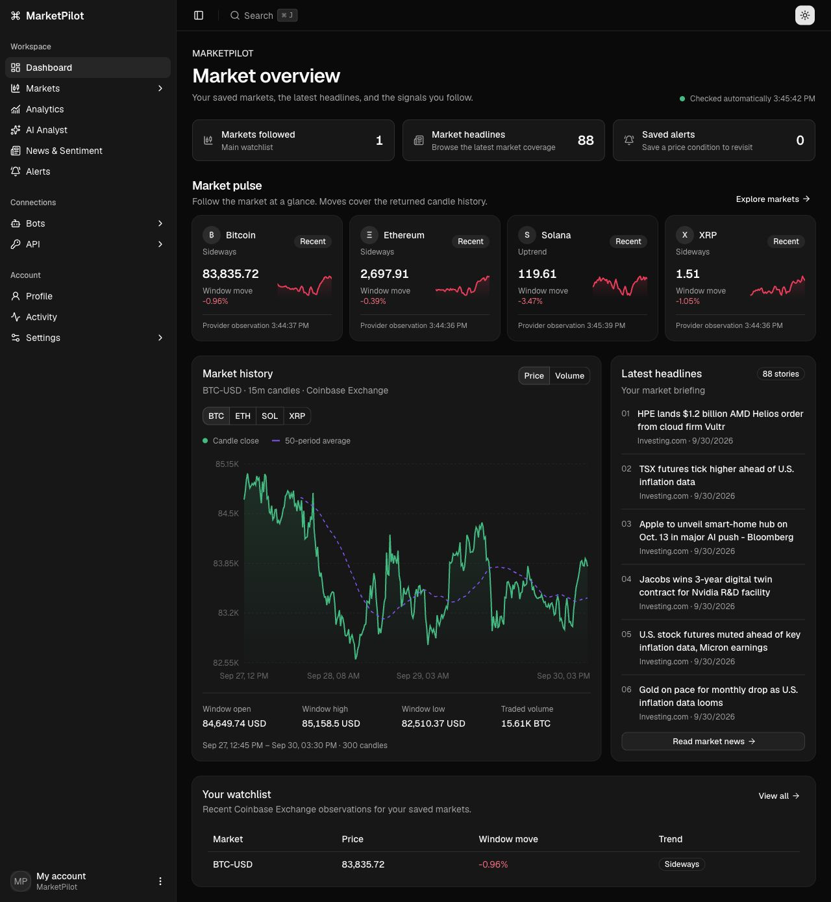
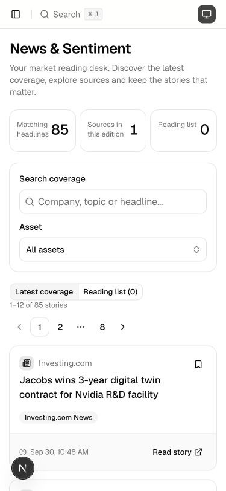
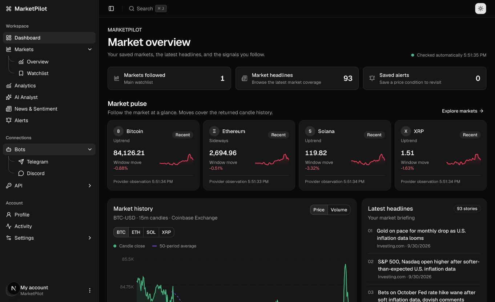
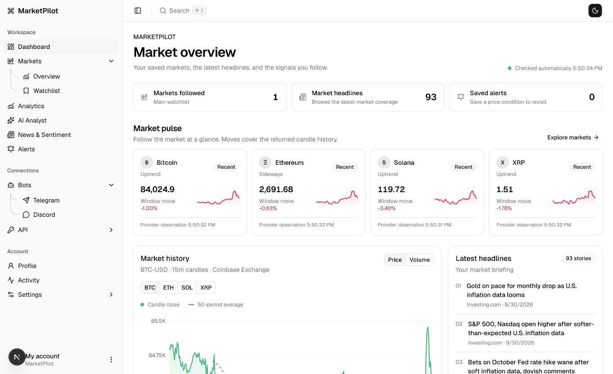

# MarketPilot interface refresh

## Reference and decisions

The reference is `Desktop/next-shadcn-admin-dashboard`. Its Finance chart composition, compact metrics, chart legends, grouped controls, and Profile header informed this refresh. MarketPilot uses its existing shadcn primitives and dashboard shell. Upstream license notices remain intact.

- **Asset selection:** a shared searchable combobox shows full asset names and pairs, supports keyboard selection, and keeps results in a bounded scroll area. The eight suggested USD pairs are a curated list, not the full exchange catalogue. Availability is checked by the API when saving.
- **Dashboard:** compact account links, market pulse sparklines, selectable price history, attributed headlines, then the watchlist. Asset controls live inside the chart header. The chart and six-story briefing share aligned top and bottom edges on desktop; mobile stacks the cards with a consistent 16px gap. Empty watchlists no longer create a tall blank column beside news. Quotes update automatically; failed refreshes retain and label older observations.
- **Markets and watchlist:** aligned selectors and actions, consistent asset identity, readable prices, candle-window moves, and real history sparklines. Window moves are not described as daily performance.
- **Analytics:** price area with a rolling 50-period average, volume view, RSI donut, and key levels. Asset and interval changes load automatically. All chart values come from API observations.
- **News:** debounced search, asset selection, server pagination, article cards, publisher previews, original-source links, and a reading list. Saved stories and drafts last only for the current visit. Filters also work in the reading list.
- **AI Analyst:** suggested questions, editable drafts, real research context, and compact tool activity. This is a clearly labelled preview; sending AI requests remains disabled and no generated answers are fabricated.
- **Profile:** a full-width identity header with account status and a direct edit action, followed by personal details and account controls.
- **Sidebar:** nested items share a continuous stem with curved branches. The stem ends at the final item. Decorations use semantic theme colors and do not intercept pointer events. Light/dark appearance and the collapsed navigation dropdown were reviewed in the browser.

Feature-specific pieces remain beside their routes. Asset selection, sparklines, market history, and momentum panels are shared. No files in `components/ui` or `components/calendar` were modified.

## Validation

`pnpm run ci` runs lint, formatting, typechecks, existing tests, and production builds. All stages passed; the 31 existing tests passed. Lint retains nonblocking warnings in the older Activity and API screens.

Manual browser review covered Dashboard, Markets, Watchlist controls, Analytics, AI Analyst, News, and Profile. Checks included asset search and keyboard selection, hourly candle loading, switching chart views, news pagination/search/preview, reading-list filtering and empty states, and saving AI drafts. Mobile checks used a 375 × 812 viewport. Light and dark themes were reviewed. No warning/error console entries were captured in these reviewed flows. Watchlist creation/deletion was covered by existing API tests; this visual review did not alter saved account data.

The dashboard spacing follow-up passed the web typecheck and targeted Biome checks (one existing ref-guard warning). Browser measurements at 1280px confirmed both research cards were 623px tall with identical top/bottom positions. At 375px the page width remained 375px, and the stacked cards had a 16px gap. BTC/ETH selection and Price/Volume switching remained functional; no warning/error console entries were captured.

## Screenshots

Actual local application captures, with API data at capture time:

